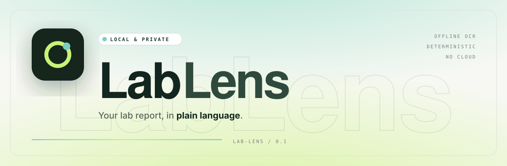
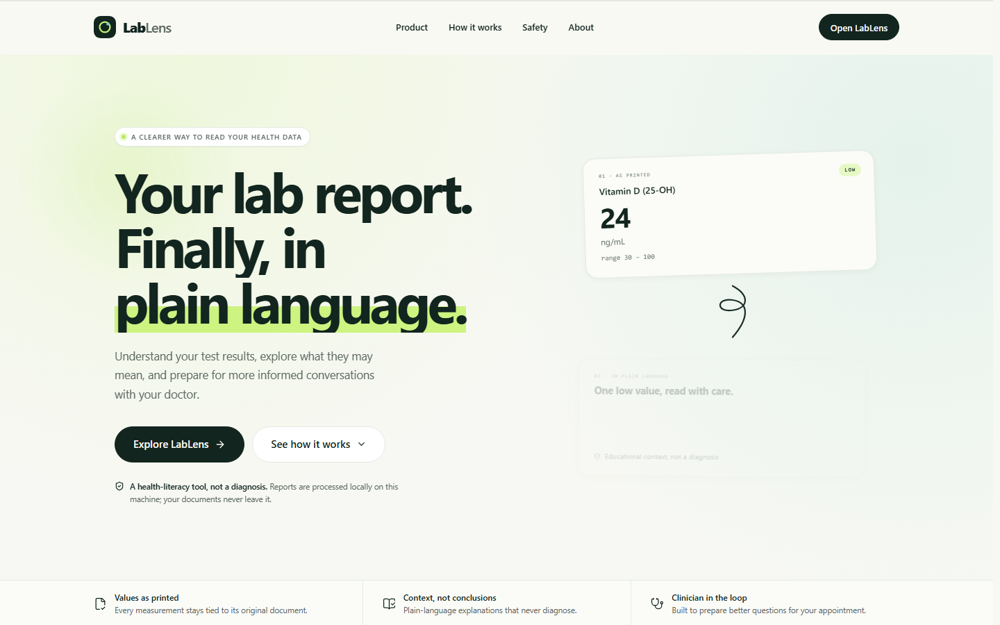
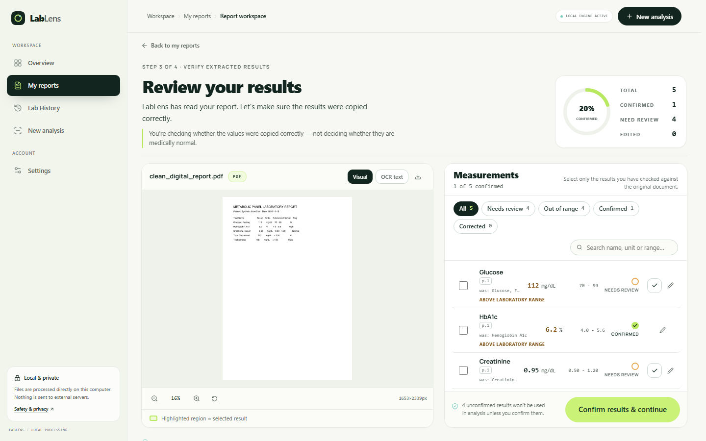
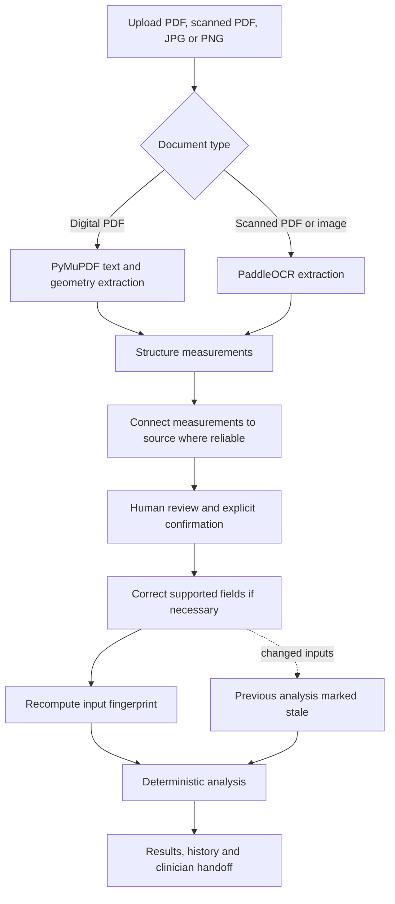

<p align="center">
  
</p>

<p align="center">
  
  
  
  
  
</p>

<p align="center">
  
  
  
  
</p>

<p align="center">
  <strong>From laboratory reports to clear, traceable information.</strong><br/>
  An evidence-first, local-first laboratory report intelligence platform.
</p>

<p align="center">
  <a href="#the-problem"><b>The problem</b></a> ·
  <a href="#what-lablens-is"><b>What it is</b></a> ·
  <a href="#why-its-different"><b>Why it's different</b></a> ·
  <a href="#product-capabilities"><b>Capabilities</b></a> ·
  <a href="#how-it-works"><b>How it works</b></a> ·
  <a href="#technology-and-architecture"><b>Architecture</b></a> ·
  <a href="#run-locally"><b>Run locally</b></a> ·
  <a href="#testing-and-engineering-validation"><b>QA</b></a> ·
  <a href="#privacy-safety-and-responsible-use"><b>Safety</b></a> ·
  <a href="#current-limitations"><b>Limitations</b></a> ·
  <a href="#demo-and-screenshots"><b>Demo</b></a> ·
  <a href="#built-by"><b>Built by</b></a>
</p>

---

## The problem

Laboratory reports contain useful health information, but they are not always easy to understand. Abbreviations, unfamiliar measurements, units, reference intervals, dense tables and scanned pages can make a report difficult to navigate — especially when the only available copy is a photograph or a scanned PDF.

Extracting text is only the first challenge. A system can read a number incorrectly, attach it to the wrong test, misread a unit, or present an old interpretation after the underlying value has changed.

LabLens was built around a different question:

> **How can laboratory information become easier to understand without losing the evidence and uncertainty behind it?**

## What LabLens is

LabLens is a full-stack application that turns laboratory reports into structured, reviewable information. It accepts digital PDFs, scanned PDFs and report photographs; extracts measurements; connects results to their source where alignment is reliable; and provides a deliberate workflow for **verification, correction, analysis, history and clinician handoff**.

It is designed as an informational and organisational companion — **not an automated doctor**. It does not diagnose medical conditions or prescribe treatment.

**LabLens doesn't ask you to blindly trust an extracted number.** It helps you trace it back to the report, review it, correct it, and understand what can responsibly be said about it.

<p align="center">
  
</p>

## Why it's different

| Typical document extraction | LabLens's approach |
|---|---|
| Returns extracted text or numbers | Organises report measurements into structured records |
| Asks users to trust extraction | Provides a review and explicit confirmation workflow |
| Can detach a value from its source | Preserves source context and visual inspection where provenance can be aligned |
| Corrections can silently replace data | Preserves original values and records corrections |
| May keep showing an old interpretation | Detects changed analysis inputs and marks earlier analysis as stale |
| Treats every result as equally interpretable | Separates extracted data, verification state, and analysis eligibility |

The central idea is simple: **make the result inspectable, not just readable.**

<p align="center">
  
  <br/><em>The verification workspace. Extraction proposes. You dispose.</em>
</p>

## Product capabilities

**1. Multiple report formats**

Upload laboratory reports as digital PDFs with selectable text, scanned or image-based PDFs, or JPG/PNG photographs. Digital PDFs take a direct text/geometry path; scanned pages use OCR. The faster digital path stays separate from the heavier OCR path.

**2. OCR built for real-world documents**

LabLens uses offline **PaddleOCR** for image-based extraction and **PyMuPDF** for digital PDF text and page geometry. The pipeline is designed around page rotation, small text, varied layouts and imperfect photographs; OCR runtime settings adapt to available hardware. CPU processing is the measured default; an attempted GPU path exists but requires a compatible GPU-enabled Paddle build — if initialisation or an inference call fails, the runtime discards the GPU attempt and retries the affected page on CPU, and reports the mode actually used. The development machine used for CPU tuning had no NVIDIA GPU.

**3. Source-linked verification**

The verification workspace brings extracted measurements and the original report together:

- Review measurements across the report; filter by review state (needs review / out-of-range / confirmed / corrected) and search.
- Select individual measurements before confirming — LabLens does not treat indiscriminate "confirm everything" as user review.
- Inspect the source page with highlights, zoom and pan; source geometry is normalised to the page so highlights stay aligned at any zoom.
- Ambiguous provenance stays unassigned rather than inventing a source match.

**4. Corrections with an audit trail**

Users can correct supported original measurement fields (original result, unit, reference range). Derived information is recalculated rather than manually overwritten. Every correction records before/after payloads and a timestamp, and the measurement returns to review-needed so it must be confirmed again.

**5. Analysis that knows when it is stale**

Analysis is tied to a SHA-256 fingerprint of its measurement inputs. Change any input afterwards and the previous analysis is marked stale *everywhere it appears* — the results page, the explanations payload, and the clinician handoff — until the report is analysed again. Old runs are preserved, never silently re-presented as current.

**6. Results and explanations**

Results organise measurements and present supported, deterministic guidance against the printed reference intervals. Explanations are a versioned, curated catalogue (26 measurement entries / 26 pattern entries, v2.0) — no generated text, each entry carries explicit *cannot-establish* and limitation clauses, and educational instead of diagnostic by construction.

**7. History and clinician handoff**

Longitudinal biomarker views built only from verified, numerically comparable observations — with explicit eligibility labels and exclusion reasons. A printable clinician handoff organises the report for your own conversation with a healthcare professional, with corrected values visibly marked and stale analyses withheld.

**8. Responsive, end-to-end experience**

One connected journey: **Upload → Process → Verify → Correct if needed → Analyse → Review → Discuss.** Desktop gets a two-column document/measurement workspace; tablet/iPad gets stacked docked inspection; mobile gets a segmented Document/Measurements control and a bottom sheet for inspection. 44 px touch targets, keyboard access, reduced-motion support.

## How it works



**The verification-first lifecycle**

1. **Upload** — the report is stored in the configured local data directory; content is hashed (SHA-256) and consent timestamp recorded.
2. **Extract** — digital PDFs use text extraction; image-based pages use OCR.
3. **Structure** — candidate measurements are organised into structured records.
4. **Inspect** — review the measurement and its available source context.
5. **Confirm** — only explicitly selected measurements are confirmed.
6. **Correct** — supported source values can be corrected while retaining the original and an audit record.
7. **Analyse** — analysis fingerprinted on its measurement inputs.
8. **Recheck freshness** — if those inputs change, the earlier analysis is no longer treated as current.

<p align="center">
  
</p>

## Technology and architecture

| Layer | Technology | Responsibility |
|---|---|---|
| Frontend | React, TypeScript, Vite | Application UI, report workflow, verification and visualisations |
| Backend API | Python, FastAPI | Upload, processing, report, verification and analysis endpoints |
| Database | SQLite (WAL, FK cascades) | Report, measurement, correction and analysis data |
| Digital PDF | PyMuPDF | Text extraction, page rendering and positional metadata |
| OCR | PaddleOCR / PaddlePaddle | Text recognition for scanned pages and images |
| Runtime selection | Hardware-aware OCR runtime | CPU/GPU selection, adaptive settings and CPU fallback |
| Source inspection | Page geometry + browser rendering | Document preview, zoom, pan and source highlights |

**Architectural principles**

- **Local-first** — processing and analysis run on the local stack and local storage; no hosted language-model API is required, ever.
- **Evidence before interpretation** — measurements stay tied to their source context where alignment is reliable.
- **Human control** — verification and correction are explicit user actions, never inferred.
- **Deterministic analysis** — comparisons are rule-based and bound to the stored report data.
- **Freshness-aware** — changes to analysis inputs invalidate the currentness of earlier analysis.
- **Graceful hardware adaptation** — OCR configuration responds to the machine; GPU use is never assumed.
- **Conservative failure handling** — ambiguous matches and stale analysis are surfaced, never silently presented as reliable.

## Application pages

| Route | Purpose |
|---|---|
| `/` | LabLens product homepage |
| `/app/start` | Application welcome and entry point |
| `/app/upload` | Upload a laboratory report |
| `/app` | Main application dashboard |
| `/app/reports` | Report list |
| `/app/reports/:reportId/verify` | Report-wide measurement verification workspace |
| `/app/reports/:reportId/results` | Report results and analysis |
| `/app/history` | Previous reports and longitudinal information |
| `/app/settings` | Application settings |

## Run locally

LabLens is a local frontend and backend application. The backend Uvicorn import path assumes the FastAPI application is exported as `app` from `backend/app/main.py`.

**Requirements**

- Python 3.12 recommended.
- Node.js compatible with the project's Vite version.
- A Windows, macOS or Linux environment capable of installing the OCR dependencies.
- Sufficient free memory and disk for OCR model files (OCR is resource-intensive on multi-page scans).

**1. Clone**

```bash
git clone https://github.com/shamith201119-ship-it/LabLens.git
cd LabLens
```

**2. Backend** (in PowerShell; use `source .venv/bin/activate` on macOS/Linux)

```powershell
cd backend
py -3.12 -m venv .venv
.\.venv\Scripts\Activate.ps1
python -m pip install --upgrade pip
pip install -r requirements.txt

New-Item -ItemType Directory -Force .\data | Out-Null
$env:LABLENS_DATA_DIR = (Resolve-Path .\data).Path
$env:LABLENS_OCR_DEVICE = "auto"

uvicorn app.main:app --reload --port 8000
```

If you also want the offline OCR path: `pip install -r requirements-ocr.txt`.

**3. Frontend** (a second terminal)

```bash
npm install
npm run dev -- --port 5174
```

Open `http://localhost:5174`. The API is expected on `127.0.0.1:8000` (configurable with `VITE_API_BASE` at build time).

**OCR device selection**

| Value | Behaviour |
|---|---|
| `auto` | Detect whether the installed Paddle runtime can initialise a supported GPU; otherwise use CPU |
| `cpu` | Force CPU OCR |
| `gpu` | Request GPU OCR when supported by the installed runtime and hardware |

`$env:LABLENS_OCR_DEVICE = "cpu"` — restart the backend after changing the setting. A GPU setting by itself does not mean acceleration is active; check the runtime information the application reports. **The development machine used for CPU tuning had no NVIDIA GPU; GPU execution is untested.**

> **Windows note:** if PowerShell blocks virtual-environment activation, use the Python environment's interpreter directly or adjust execution policy thoughtfully. Do not weaken system-wide security just to run the project.

## Testing and engineering validation

LabLens has been developed with focused backend tests, browser-based workflow checks, extraction fixtures, and build/lint validation.

Documented verification results at the current checkpoint:

- **29/29 focused backend tests** (verification, corrections, freshness, isolation guard) — always on an auto-isolated temporary database by `backend/tests/conftest.py`.
- **320/320 browser QA checks** across the verification workspace, source inspection, completion flow, responsive layouts, accessibility, loader lifecycle and end-to-end journeys.
- **Frontend lint, type-check and production build** all clean.
- **Synthetic OCR regression fixtures** — 158/158 and 108/108 assertions in the master benchmark and small-text stress set respectively; source/page attribution 15/15 and 18/18.
- **Real, isolated QA runs**: every browser QA phase ran against a throwaway `LABLENS_DATA_DIR` on a separate port, never the development database.

These are recorded engineering results — **not a claim of clinical validation or guaranteed accuracy on arbitrary laboratory reports.** Test counts evolve with the code. Synthetic fixtures are useful for regression detection but cannot represent every real-world layout.

**Run the checks**

```bash
# frontend
npm run lint
npm run typecheck
npm run build

# backend (isolated temp data dir forced by tests/conftest.py)
cd backend
pytest tests/test_verify_selected.py tests/test_corrected_state.py tests/test_phase9_9_2_analysis_freshness.py tests/test_pytest_db_isolation.py
```

## Privacy, safety and responsible use

Laboratory reports contain highly sensitive personal information. LabLens is built around a local-first architecture, but deployment configuration still matters:

- Keep uploaded reports, SQLite databases, temporary files and environment files **out of version control** (see `.gitignore` — `data/`, `*.db*` are excluded by default).
- Use a single dedicated data directory and restrict access to the machine/account that owns it.
- Do **not** use real patient documents in public screenshots, demo recordings, issue reports or fixtures unless you have explicit authorisation.
- Do not expose a development server or local data directory to the public internet without a separate security review.
- OCR output is fallible — review measurements against the original report.
- A reference-interval flag is not a diagnosis. Intervals vary by laboratory, method, population and patient context.
- Discuss medical concerns and clinical decisions with a qualified professional.

LabLens is **not a medical device, diagnostic system, emergency service or substitute for professional medical advice.** It is an informational tool to organise and inspect laboratory report information. What it does well: stopping an unchecked extraction from silently steering analysis.

## Current limitations

Being explicit about limitations is part of building a trustworthy product.

- Extraction quality depends on image quality, layout, scan resolution, text size and OCR performance.
- Source highlighting is only as reliable as the available geometry and the alignment between extracted text and structured measurements. Ambiguous matches are not treated as confirmed provenance.
- Supported explanations and patterns are limited to the implemented deterministic catalogue and rules; not every marker or clinical relationship is covered.
- Longitudinal comparisons depend on compatible measurements, units, dates and records.
- OCR performance varies with CPU, memory, page count and image complexity.
- GPU execution has fallback handling, but physical GPU success must be validated on your target machine — the development machine for CPU tuning had no NVIDIA GPU.
- The project has **not** undergone clinical validation and must not be used to make diagnosis or treatment decisions.
- Catalogue citations reference guideline bodies without pinned edition/retrieval dates.
- Explanations contain no dosages, no treatment plans and no urgency claims; that is deliberate and permanent without clinical governance.

## Demo and screenshots

The verification-first journey is best seen live. A pre-built QA gallery lives in this repository under `artifacts/qa/full-product-audit/screenshots/` (all synthetic data) — the marketing site, verification, completion, results, clinician handoff and loader/perf captures from the final submission-readiness pass.

**Suggested 5-minute demo**

1. Cold open on the landing page — a branded launch beat, then the hero settles. No spinner, no clutter.
2. Upload the synthetic report → watch real page-level extraction progress.
3. Select **only HbA1c**, confirm. Analysis excludes the other four — out loud.
4. Edit it (6.2 → 6.0). Watch every result surface go stale; handoff withholds guidance; re-verify → restored.
5. Open **Lab History**; show verified-only trend with excluded points visible.
6. Print **Prepare for your appointment**.

Full talk track, claims discipline and QA evidence: `artifacts/phase-8.1/SUBMISSION_READINESS_REPORT.md` and `SUBMISSION_CHECKLIST.md`.

## Roadmap

- Broader extraction coverage across laboratory formats and layouts.
- Stronger evidence visibility for measurements that cannot currently be interpreted.
- More robust longitudinal comparisons with date-aware timelines and compatible-unit handling.
- Expanded, carefully sourced explanations for additional laboratory markers.
- More complete provenance/audit context in clinician-facing exports.
- Wider hardware testing, including physical GPU validation and low-memory environments.
- Additional accessibility, responsive design and end-to-end regression coverage.

The priority is not to produce more interpretation at any cost. It is to improve coverage while preserving traceability, uncertainty and user control.

## Contributing

LabLens is a hackathon project and is still evolving. Bug reports, thoughtful feedback and contributions that improve reliability are welcome.

When opening an issue or pull request:

- Describe the problem and the expected behaviour.
- Include safe reproduction steps and logs with personal data removed.
- Add or update tests for behaviour changes where practical.
- Avoid committing real laboratory reports, personal information, credentials, databases or local OCR assets.
- Keep medical claims conservative and link to credible references when proposing new explanations.

## Built by

**Shamith Rai** — independently developed for **DSH Hacks V2**.

LabLens started as an attempt to make laboratory reports less intimidating. It became an engineering project about something more fundamental: how to build useful automation without hiding the evidence, uncertainty or human decisions behind it.

<div align="center">

### Make the report understandable. Keep the evidence visible.
**LabLens — clarity with traceability.**

</div>
