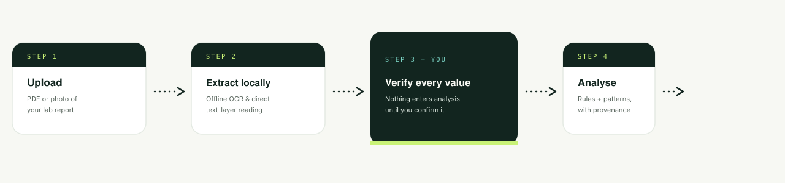
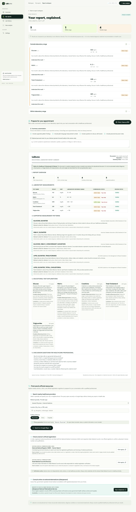

<!-- LabLens — local-first health-literacy workspace -->
<!-- banner rendered by GitHub from the checked-in SVG -->

<p align="center">
  
</p>

<p align="center">
  <a href="#why-lablens"></a>&nbsp;&nbsp;&nbsp;&nbsp;
</p>

<h3 align="center">Your lab report, in plain language.<br/><sub>Verified, not guessed. Explained, not judged.</sub></h3>

<p align="center">
  <a href="#quick-start"><b>Quick start</b></a> ·
  <a href="#how-it-works"><b>How it works</b></a> ·
  <a href="#safety-and-honesty"><b>Safety &amp; honesty</b></a> ·
  <a href="#architecture"><b>Architecture</b></a> ·
  <a href="#demo-script"><b>Demo script</b></a> ·
  <a href="#limitations"><b>Limitations</b></a>
</p>

---

## Why LabLens

Every year, millions of lab results land in patient portals as raw PDFs — values, units, reference intervals, flags — with no translation layer between the paper and the person. The dangerous parts aren't usually the numbers. They're the silence around them: *"High"* means "above your lab's printed interval," not "you are sick." Existing tools either do nothing, or they shout confident nonsense.

**LabLens treats your report as a document, not an oracle.**

- It **transcribes, then asks**. Every measurement is transcribed locally — by OCR for scans and photos, by direct text-layer reading for digital PDFs — and then **waits for you to verify it** before anything is analysed.
- It **never pretends to be a doctor**. It compares each verified value to *your laboratory's own printed reference interval*. It surfaces deterministic, reproducible pattern findings. It does not diagnose, triage, dose, or reassure.
- It **refuses to lie to you in its own UI**. If measurements change after analysis, the previous analysis is marked stale *everywhere it appears* — results page, printout, and clinician summary. Unverified measurements are **structurally excluded** from analysis. Acknowledgement of a partial review verifies **nothing** — by design and by test.
- It **stays on your machine**. OCR, extraction, analysis, storage — all local. No telemetry. No account. No health data ever leaves the device.

<p align="center">
  
</p>

## What's different about it

| Most "AI health" demos | LabLens |
|---|---|
| "Upload your labs" → instant confident summary | Transcribe → **verify** → then a summary you can act on |
| LLM-flavored explanations of dubious provenance | Versioned, deterministic catalogue (26 measurement + 26 pattern entries) with explicit *cannot-establish* clauses |
| "Your score is 82/100" | No health scores. No diagnoses. No verdicts. |
| Cloud processing, accounts, telemetry | Files processed on this machine; nothing leaves it |
| Analysis never expires | Editing any measurement **invalidates the analysis everywhere** — deterministic SHA-256 fingerprinting of every analysis input, checked freshness on every read |
| Unverified OCR rows silently enter analysis | Ineligible rows never reach the comparison engine — proven at the service layer, not just the UI |
| A generic PDF dump for your doctor | A clinician-ready handoff document with original values, corrections marked, provenance and freshness withholding |

<p align="center">
  
  <br/><em>The verification workspace. Extraction proposes. You dispose.</em>
</p>

## How it works

<p align="center">
  
</p>

1. **Upload** — PDF or photograph of a lab report. Consent timestamp is recorded; content is hashed (SHA-256) and stored locally.
2. **Extract locally** — Digital PDFs are read directly from the text layer (fast, exact). Scans and photos go through an offline **PaddleOCR** pipeline (PP-OCRv6, CPU, adaptive thread/batch tuning) with a built-in CPU-vs-GPU capability probe and safe fallback.
3. **Verify every value** — You inspect each measurement against the original page, edit what the machine misread, and explicitly confirm. Only verified, supported measurements can reach analysis. Bulk-confirm confirms *your selection* — never more.
4. **Analyse** — A deterministic engine compares each verified value to the printed reference interval, flags criticals from the lab's own flags, and runs 26 reviewed pattern rules (CBC, glucose/HbA1c, lipids, liver, kidney) — every finding carries frozen evidence IDs.
5. **Use it** — Results are grouped for humans, explanations stay educational, clinician printouts carry provenance. Freshness is honest: any edit makes the previous analysis *out of date everywhere* until re-run.

<p align="center">
  
  <br/><em>Results. Honest labels, explicit exclusions, nothing invented.</em>
</p>

## Safety and honesty, verified

This is the part most health-adjacent apps hand-wave. LabLens tests it.

**Freshness fingerprinting.** Every analysis run stores a SHA-256 over *everything* analysis consumes — values, units, ranges, flags, verification status — recomputed on every read. Change one character and the previous analysis is marked `stale` on the results page, in the explanation payload, and in the printable clinician handoff (which withholds guidance until you re-verify and re-run). Old runs are preserved, never silently rehydrated.

**Acknowledgement is not verification.** Partial completion shows exactly what's confirmed, what's corrected, and what remains unverified — "4 results remain unverified" — with an explicit gallery of excluded measurements and a checkbox that *writes nothing* until you tick it. Finishing for now leaves those measurements unverified, unanalysed and unlisted.

**The gate is structural.** `analyse_report()` only ever sees rows where `verification_status = 'verified'` **and** `test_code IS NOT NULL`. Ineligible measurements do not become assessments, never enter pattern rules, and never leak into trends.

**Claimed, and proven.** Every one of the above has automated tests bound to this repository: dedicated service tests (`test_verify_selected`, `test_corrected_state`, `test_phase9_9_2_analysis_freshness`, `test_pytest_db_isolation` — 29/29 passing on an auto-isolated database), plus browser-verified flows: 140/140 integrity checks, 67/67 completion/responsive checks, 20/20 inspection checks, 70/70 width checks.

| Proof on record | Value |
|---|---|
| Synthetic fixture accuracy (engineering benchmark — *not clinical validation*) | 29/29 measurements extracted on 6 synthetic fixtures; 1.0 recall/precision |
| CPU-tuned OCR wall clock (this machine, identical accuracy) | 162.0 s → 142.5 s across the five-category suite (−12 %) |
| Digital pipeline bench | 0.46–0.58 s per report on a 2-core i3-1005G1 |
| Browser QA | 140/140 + 67/67 + 20/20 + 70/70 + 16/16 green |
| Backend tests | 29/29 green, forced-temp-DB isolation |

## Quick start

**Prerequisites** — Python 3.12+, Node.js 20+, ~4 GB RAM for the OCR path (CPU).

```bash
git clone https://github.com/shamith201119-ship-it/LabLens.git
cd LabLens

# Backend (creates an isolated local data dir)
python -m venv .venv
.venv\Scripts\activate          # Windows  ·  source .venv/bin/activate  (macOS/Linux)
pip install -r backend/requirements.txt
# Optional offline OCR (large download; CPU-only)
pip install -r backend/requirements-ocr.txt

# Frontend
npm install

# Run (two terminals)
set LABLENS_DATA_DIR=%cd%\backend\data   &&  python -m uvicorn app.main:app --host 127.0.0.1 --port 8000 --app-dir backend
npm run dev
```

Open <http://localhost:5173>, upload `backend/tests/fixtures/phase8_1_accuracy/clean_digital_report.pdf` (a synthetic 5-measurement report) and follow the flow.

> **Why two servers?** The frontend is a static Vite SPA; the backend is a local FastAPI service. Both bind to loopback. There is nothing else.

### Useful commands

| Task | Command |
|---|---|
| Type-check | `npm run typecheck` |
| Lint | `npm run lint` |
| Production build | `npm run build` |
| Focused backend tests | `cd backend && python -m pytest tests/test_verify_selected.py tests/test_corrected_state.py tests/test_phase9_9_2_analysis_freshness.py` |
| Load/e2e harnesses | see `artifacts/qa/full-product-audit/` |
| Print the clinician handoff | results page → **Preparation · Print / Save as PDF** |

## Architecture

```
┌─────────────────────────────┐        ┌──────────────────────────────┐
│  React 19 · TypeScript SPA  │        │  FastAPI (127.0.0.1:8000)    │
│  Vite build · React Router  │ HTTP   │  app/                        │
│  ── pages ───────────────   │ ─────► │  routes/    HTTP surface     │
│   Marketing · Upload        │        │  services/  extraction        │
│   Processing · Verify       │        │             analysis (Phase 4)│
│   Results · History         │        │             explanations v2.0 │
│  ── features ────────────   │        │             history (Phase 7) │
│   engine-honest workspace   │        │  catalogue/ deterministic math │
└─────────────────────────────┘        │  SQLite WAL · FK cascades    │
                                       └──────────────────────────────┘
```

- **Verification is the product.** The Phase 9 verification workspace (44 px touch targets, bottom sheet on mobile, right-rail inspector on desktop, deterministic focus restoration, `aria-modal` sheet, reduced-motion support) is the centre of the interaction model.
- **Extraction is evidence, not insight.** Measurements carry `source_bbox`, page number, original test name, lab flag, derived flag *and* an audit trail (`measurement_corrections`).
- **Determinism over cleverness.** Analysis, explanation and pattern detection never call a model. Every number in this README's proof table is reproducible offline.

## Repository tour

```
src/                React frontend (pages, components, verification workspace)
backend/app/        FastAPI application (routes, services, analysis engine)
backend/tests/      29 focused tests (verification, corrections, freshness)
backend/tests/fixtures/   Synthetic truth sets used by CI/QA (never clinical data)
artifacts/phase-8.1/      Product audits, benchmarks and the intelligence audit
artifacts/qa/             Browser QA harnesses + screenshots (Playwright, 9.11.x)
docs/assets/              Brand assets (this README's artwork)
```

## Demo script (for judges)

1. **Cold open.** First load — a single branded beat, then the hero settles (`/`). No spinner, no sloppiness.
2. Upload the synthetic report → watch **real** page-level extraction progress (not simulated).
3. Select **only HbA1c**, confirm it. Analysis excludes the other four — aloud.
4. **Edit it** (6.2 → 6.0). Every result surface poisons itself; the printable handoff withholds guidance. Fix it — clean slate restores itself.
5. Open **Lab History**; show verified-only trend with explicit exclusions.
6. Print **Prepare for your appointment**. That page is the pitch.

Step-by-step talk track, claims discipline and QA evidence: `artifacts/phase-8.1/SUBMISSION_READINESS_REPORT.md`.

## Limitations — read this before citing us

- **This is not a medical device and has never been clinically validated.** No clinical study, no regulatory review, no clinician sign-off exists for any content, rule or copy in this repository.
- OCR accuracy numbers are **synthetic engineering benchmarks** (fixtures authored for this project), not clinical accuracy and not a promise about your report.
- Analysis is **educational context, not diagnosis, triage, dosing or treatment**. Printouts are for your own clinician conversation.
- The reference interval always comes from **your laboratory report** — LabLens never substitutes a population norm.
- GPU inference is untested (this repository was developed on CPU-only hardware); the CPU path is the measured path.
- Explanations cite public guidelines without pinned editions. They are safe, silent where evidence is absent, and curated — not generated.
- Care-navigation links are India-first (community, government telemedicine, NMC registries) and purely pointer, never referrals.

## Roadmap

Planned only, in strict order (see `artifacts/phase-8.1/LABLENS_INTELLIGENCE_AUDIT.md`):

1. **9.12.1 — "Evidence You Can Hand Over"**: honest result-page denominators, exclusion ledger on results and in print, handoff provenance footer, trend v2 (time-axis + reference band), explanation evidence jump links.
2. **9.12.2+**: catalogue completion for six missing canonical biomarkers, unit-safe trend conversion, printable one-page appointment brief.
3. **Later**: clinician-reviewed pattern rulesets — only with review; nothing diagnostic ships without it.

## Contributing & security

This is a hackathon-phase repository. Issues and PRs are welcome, but safety copy, analysis rules and the verification gate change only with review. **Do not** file publicly discoverable reports containing health data; open a minimal synthetic reproduction instead. To report a security concern, contact the maintainer privately rather than via a public issue.

## Acknowledgements

Synthetic reports were generated for this project and carry obvious fictional markers. The upload pipeline, OCR stack (PaddleOCR PP-OCRv6), deterministic catalogue and freshness design are documented in `artifacts/`. Vision or diagnosis — or their simulacra — were deliberately not built.

---

<p align="center"><sub>LabLens is educational software. It is not medical advice, diagnosis or treatment.<br/>Built local-first, measured honestly, and proud of the difference.</sub></p>
