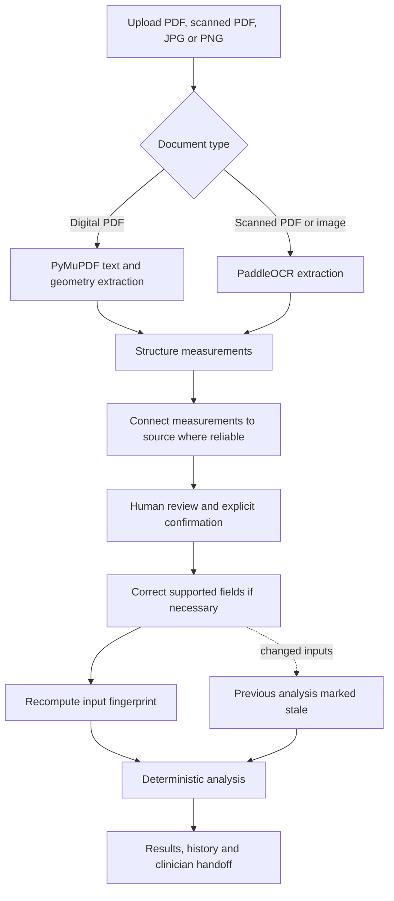

<div align="center">
🧪 LabLens
From laboratory reports to clear, traceable health information.
An evidence-first, local-first laboratory report intelligence platform.


LabLens doesn't ask you to blindly trust an extracted number. It helps you trace it back to the report, review it, correct it, and understand what can responsibly be said about it.
</div>
---
The problem
Laboratory reports contain useful health information, but they are not always easy to understand. Abbreviations, unfamiliar measurements, units, reference intervals, dense tables, and scanned pages can make a report difficult to navigate—especially when the only available copy is a photograph or a scanned PDF.
Extracting text is only the first challenge. A system can read a number incorrectly, attach it to the wrong test, misread a unit, or present an old interpretation after the underlying value has changed.
LabLens was built around a different question: how can laboratory information become easier to understand without losing the evidence and uncertainty behind it?
What is LabLens?
LabLens is a full-stack application that turns laboratory reports into structured, reviewable information. It accepts digital PDFs, scanned PDFs, and report photographs; extracts measurements; connects results to their source where alignment is reliable; and provides a deliberate workflow for verification, correction, analysis, history, and clinician handoff.
It is designed as an informational and organizational companion, not an automated doctor. It does not diagnose medical conditions or prescribe treatment.
Why it is different
Typical document extraction	LabLens's approach
Returns extracted text or numbers	Organizes report measurements into structured records
Asks users to trust extraction	Provides a review and explicit confirmation workflow
Can detach a value from its source	Preserves source context and visual inspection where provenance can be aligned
Corrections can silently replace data	Preserves original values and records corrections
May keep showing an old interpretation	Detects changed analysis inputs and marks earlier analysis as stale
Treats every result as equally interpretable	Separates extracted data, verification state, and analysis eligibility
The central idea is simple: make the result inspectable, not just readable.
---
✨ Product capabilities
1. Multiple report formats
Upload laboratory reports as:
Digital PDFs with selectable text.
Scanned or image-based PDFs.
JPG and PNG photographs or scans.
Digital PDFs use text and positional extraction. Scanned pages and images use OCR. This keeps the faster digital-document path separate from the more computationally demanding OCR path.
2. OCR built for real-world documents
LabLens uses PaddleOCR for image-based extraction and PyMuPDF for digital PDF text and page geometry.
The extraction pipeline is designed to handle practical document issues such as page rotation, small text, varied layouts, and imperfect photographs. OCR runtime settings adapt to available hardware, and the runtime can use CPU processing or attempt GPU execution when the installed Paddle runtime and device support it.
When GPU initialization or execution fails, the runtime can discard the failed GPU attempt and retry the affected image on CPU. The interface reports the execution mode actually used rather than implying that a GPU was used when it was not.
3. Source-linked verification
A number without its source can be difficult to trust. The verification workspace brings the extracted measurements and original report together so a person can inspect the evidence.
Review measurements across the report.
Filter by review state, including items needing review, out-of-range items, confirmed items, and corrected items.
Select individual measurements before confirming them.
Inspect the source page and available visual highlights.
Zoom and pan the source document for closer inspection.
Keep ambiguous provenance unassigned rather than inventing a source match.
For digital PDFs, text-level positional metadata can be aligned with extracted measurements when the match is unambiguous. Source geometry is normalized to the page so highlights remain aligned when the rendered page is displayed at different sizes.
4. Corrections with an audit trail
Extraction is not perfect, so correction is part of the product—not an afterthought.
Users can correct supported original measurement fields, including the original result, unit, and reference range. Derived information is recalculated rather than manually overwritten. A correction is recorded with before-and-after information, and the measurement returns to a review-needed state so the corrected value must be explicitly confirmed again.
5. Analysis that knows when it is stale
LabLens keeps analysis separate from the source measurements. It fingerprints the inputs used for an analysis and compares that fingerprint with the current measurement state.
If a measurement changes, an earlier analysis is marked stale. Stale explanations and pattern-based guidance are withheld until the report is analysed again. This avoids presenting an interpretation as current when it was generated from older inputs.
6. Results and explanations
The results experience organizes measurements and presents supported, deterministic information in context, including comparisons with the reference ranges supplied by the report. It is designed to distinguish what was extracted, what has been reviewed, and what the analysis can support.
LabLens is intentionally conservative: a reference-range flag is not a diagnosis, and an informational pattern is not a substitute for clinical interpretation.
7. History and clinician handoff
The application includes report history and longitudinal views so users can revisit previous reports and compare available measurements over time. A clinician-facing handoff helps organize report information for a conversation with a healthcare professional.
Historical values remain historical: they should not be confused with a current result or a current analysis.
8. Responsive, end-to-end experience
The product journey is designed as one connected workflow:
Upload → Process → Verify → Correct if needed → Analyse → Review → Discuss
The interface includes desktop, tablet, and mobile layouts, with dedicated document and measurement review controls on smaller screens.
---
🧭 How it works

The verification-first lifecycle
Upload: The report is stored in the configured local data directory.
Extract: Digital PDFs use text extraction; image-based pages use OCR.
Structure: Candidate measurements are organized into structured records.
Inspect: The user can review the measurement and its available source context.
Confirm: Only explicitly selected measurements are confirmed. LabLens does not treat an indiscriminate “confirm everything” action as user review.
Correct: Supported source values can be corrected while retaining the original and an audit record.
Analyse: Analysis is tied to a fingerprint of its measurement inputs.
Recheck freshness: If those inputs change, the earlier analysis is no longer treated as current.
---
🏗️ Technology and architecture
Layer	Technology	Responsibility
Frontend	React, TypeScript, Vite	Application UI, report workflow, verification and visualizations
Backend API	Python, FastAPI	Upload, processing, report, verification and analysis endpoints
Database	SQLite	Structured report, measurement, correction and analysis data
Digital PDF processing	PyMuPDF	Text extraction, page rendering and positional metadata
OCR	PaddleOCR / PaddlePaddle	Text recognition for scanned pages and images
Runtime selection	Hardware-aware OCR runtime	CPU/GPU selection, adaptive settings and CPU fallback
Source inspection	Page geometry and browser rendering	Document preview, zoom, pan and source highlights
Architectural principles
Local-first: Core processing and analysis are designed to run through the local application stack and local storage, rather than requiring a hosted language-model API.
Evidence before interpretation: Extracted measurements remain connected to their source context where reliable alignment is possible.
Human control: Verification and correction are explicit user actions.
Deterministic analysis: Core measurement comparisons are rule-based and tied to the available report data.
Freshness-aware: Changes to analysis inputs invalidate the currentness of an earlier analysis.
Graceful hardware adaptation: OCR configuration responds to available resources, and GPU use is not assumed.
Conservative failure handling: Ambiguous source matches and stale analysis are surfaced rather than silently presented as reliable current information.
---
🖥️ Application pages
Route	Purpose
`/`	LabLens product homepage
`/app/start`	Application welcome and entry point
`/app/upload`	Upload a laboratory report
`/app`	Main application dashboard
`/app/reports`	Report list
`/app/reports/:reportId/verify`	Report-wide measurement verification workspace
`/app/reports/:reportId/results`	Report results and analysis
`/app/history`	Previous reports and longitudinal information
`/app/settings`	Application settings
---
🚀 Run locally
LabLens is developed as a local frontend and backend application. The commands below describe the standard development workflow. The backend Uvicorn import path assumes the FastAPI application is exported as `app` from `backend/app/main.py`; adjust that target if your checked-out revision uses a different entry point.
Requirements
Python 3.12 recommended for the development environment.
Node.js and npm compatible with the project's Vite version.
A Windows, macOS, or Linux environment capable of installing the Python OCR dependencies.
Sufficient free memory and disk space for OCR model files and uploaded reports. OCR can be resource-intensive, especially for multi-page scans.
1. Clone the repository
```bash
git clone <YOUR_REPOSITORY_URL>
cd <YOUR_REPOSITORY_DIRECTORY>
```
2. Set up the backend
From the repository root, in PowerShell:
```powershell
cd backend
py -3.12 -m venv .venv
.\.venv\Scripts\Activate.ps1
python -m pip install --upgrade pip
pip install -r requirements.txt
```
Create/use a dedicated local data directory for this development instance. Set the variable before starting the backend so database and file paths resolve consistently:
```powershell
New-Item -ItemType Directory -Force .\data | Out-Null
$env:LABLENS_DATA_DIR = (Resolve-Path .\data).Path
$env:LABLENS_OCR_DEVICE = "auto"
```
Start the API (assuming the entry point described above):
```powershell
uvicorn app.main:app --reload --port 8000
```
3. Set up the frontend
Open a second terminal at the directory containing the frontend `package.json`:
```bash
npm install
npm run dev -- --port 5174
```
Then open:
```text
http://localhost:5174
```
The backend development server is expected on port `8000`. If your local Vite configuration uses a proxy or a different API base URL, keep that configuration consistent with the backend address.
OCR device selection
The OCR runtime supports the following setting:
Value	Behaviour
`auto`	Detect whether the installed Paddle runtime can initialize a supported GPU; otherwise use CPU
`cpu`	Force CPU OCR
`gpu`	Request GPU OCR when supported by the installed runtime and hardware
For example, in PowerShell:
```powershell
$env:LABLENS_OCR_DEVICE = "cpu"
```
Restart the backend after changing the setting. Actual GPU use depends on compatible hardware, drivers, and a GPU-enabled Paddle installation. A GPU setting by itself does not mean GPU acceleration is active; check the runtime information reported by the application.
> **Windows note:** If PowerShell blocks virtual-environment activation, use the Python environment's interpreter directly or follow your machine's execution-policy guidance. Do not change system-wide security settings just to run the project.
---
🧪 Testing and engineering validation
LabLens has been developed with focused backend tests, browser-based workflow checks, extraction fixtures, and build/lint validation.
At a documented verification checkpoint, the project recorded:
227 browser checks across the verification workspace, source inspection, completion flow, responsive layouts, accessibility, and interaction regressions.
29 focused backend tests in the final verification milestone.
Frontend lint, type-check/build validation completed successfully at that milestone.
Synthetic OCR regression fixtures: 158/158 assertions in the master benchmark and 108/108 assertions in the small-text stress set.
Source/page attribution fixture checks: 15/15 and 18/18 in the recorded benchmark runs.
These are recorded development-test results, not a claim of clinical validation or guaranteed accuracy on every laboratory report. Test counts can change as the project evolves. Synthetic fixtures are useful for regression detection but cannot represent every real-world document layout.
Run the checks
From the frontend package directory:
```bash
npm run lint
npm run build
```
From the backend directory, with the project's test dependencies installed:
```bash
pytest
```
The backend test configuration isolates pytest database and file writes in a temporary test data directory. Keep that isolation in place. Standalone diagnostic scripts should set `LABLENS_DATA_DIR` before importing backend application modules and should verify that their resolved paths stay inside the intended test directory.
---
🔐 Privacy, safety, and responsible use
Laboratory reports can contain highly sensitive personal information. LabLens is designed with a local-first architecture, but deployment configuration still matters.
Keep uploaded reports, SQLite databases, temporary files, and local environment files out of version control.
Use a dedicated data directory and restrict access to the machine/account that owns it.
Do not use real patient documents in public screenshots, demo recordings, issue reports, or test fixtures unless you have explicit authorization and have handled the data appropriately.
Do not expose a development server or local data directory to the public internet without a separate security review.
Treat OCR output as fallible and review measurements against the original report.
A reference-range comparison is not a diagnosis. Reference intervals can vary by laboratory, method, population, and patient context.
Discuss medical concerns and clinical decisions with a qualified healthcare professional.
LabLens is not a medical device, diagnostic system, emergency service, or substitute for professional medical advice. It is an informational tool to help organize and inspect laboratory report information.
---
⚠️ Current limitations
Being explicit about limitations is part of building a trustworthy product.
Extraction quality depends on image quality, document layout, scan resolution, text size, and OCR performance.
Source highlighting is only as reliable as the available geometry and the alignment between extracted text and structured measurements. Ambiguous matches should not be treated as confirmed provenance.
Supported measurement explanations and patterns are limited to the implemented deterministic catalog and rules; not every possible laboratory marker or clinical relationship is covered.
Longitudinal comparisons depend on compatible measurements, units, dates, and available historical records.
OCR performance varies significantly with CPU, memory, page count, and image complexity.
GPU execution has fallback handling, but physical GPU success must be validated on the target machine with a compatible GPU-enabled Paddle installation. The development machine used for CPU tuning did not have an NVIDIA GPU.
The project has not undergone clinical validation and should not be used to make diagnosis or treatment decisions.
---
🗺️ Roadmap
Areas for continued development include:
Broader extraction coverage across laboratory formats and layouts.
Stronger evidence visibility for measurements that cannot currently be interpreted.
More robust longitudinal comparisons with date-aware timelines and compatible-unit handling.
Expanded, carefully sourced explanations for additional laboratory markers.
More complete provenance and audit context in clinician-facing exports.
Wider hardware testing, including physical GPU validation and low-memory environments.
Additional accessibility, responsive design, and end-to-end regression coverage.
The priority is not to produce more interpretation at any cost. It is to improve coverage while preserving traceability, uncertainty, and user control.
---
🎬 Demo and screenshots
A product walkthrough is the best way to see the full workflow: upload a report, inspect extracted measurements, verify selected values, make a correction, and see how LabLens handles analysis freshness.
Add the final demo video and real application screenshots here when they are published. Use synthetic or properly de-identified reports in public media—never expose personal laboratory information.
<!-- Suggested assets once available:


Demo video: https://<your-demo-video-url>
---
🤝 Contributing
LabLens is a hackathon project and is still evolving. Bug reports, thoughtful feedback, and contributions that improve reliability are welcome.
When opening an issue or pull request:
Describe the problem and the expected behaviour.
Include safe reproduction steps and relevant logs with personal data removed.
Add or update tests for behaviour changes where practical.
Avoid committing real laboratory reports, personal information, credentials, databases, or local OCR assets.
Keep medical claims conservative and link to credible references when proposing new explanations.
---
👨‍💻 Built by
Shamith Rai — independently developed for DSH Hacks V2.
LabLens started as an attempt to make laboratory reports less intimidating. It became an engineering project about something more fundamental: how to build useful automation without hiding the evidence, uncertainty, or human decisions behind it.
<div align="center">
Make the report understandable. Keep the evidence visible.
LabLens — clarity with traceability.
</div>